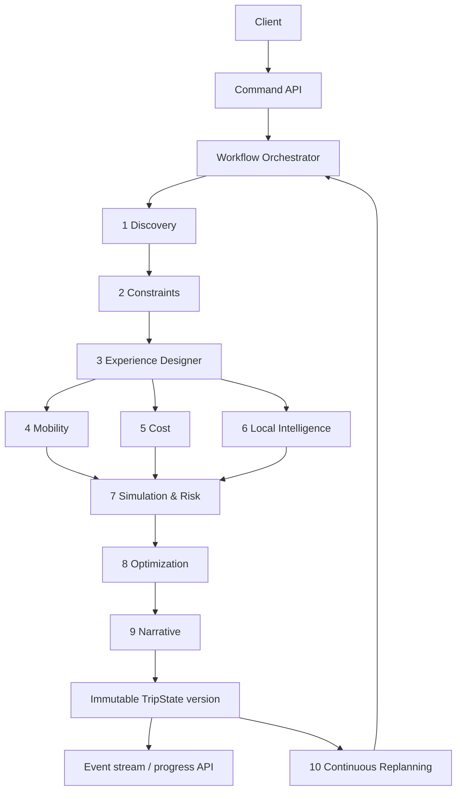
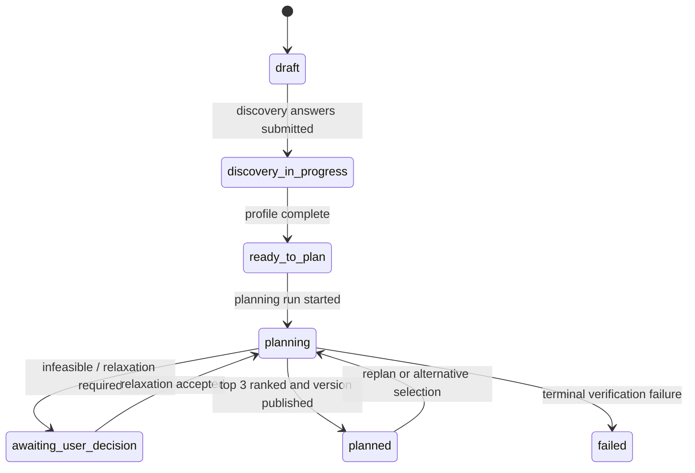

# Agentic Travel Planner — System Contract

**Contract version:** `1.0.0`  
**Schema dialect:** JSON Schema Draft 2020-12  
**Status:** MVP canonical contract

## 1. Architecture

The MVP is a single asynchronous planning workflow. The ten agents are typed modules owned by separate teams, not independently deployed services. The orchestrator is the only component allowed to merge agent patches, change a run status, create a version, or emit a public event.



The `TripState` schema is the canonical interchange object. Agent output is an `AgentPatch`, validated against the agent's owned paths before it is merged. Agents may read declared input slices only; they never mutate persistent state or another agent's output.

## 2. Lifecycle, versions, and events



Every published result is an immutable `TripState` snapshot. `trip_id` identifies the traveler’s logical trip; `version` increments for every published itinerary or explicit alternative selection; `parent_version` identifies lineage. A planning run is ephemeral work identified by `run_id`, but its important lifecycle changes are appended as events.

Public event types are defined in [`json/openapi.json`](json/openapi.json) (and documented in [`md/OPENAPI_SPECIFICATION.md`](md/OPENAPI_SPECIFICATION.md)): `trip.created`, `discovery.updated`, `planning.started`, `agent.completed`, `planning.awaiting_user_decision`, `itinerary.published`, `replan.requested`, and `planning.failed`. Each contains `event_id`, `occurred_at`, `trip_id`, `run_id`, `version`, and a typed payload.

## 3. Canonical data rules

- All money is `{ amount, currency }`; `currency` is ISO 4217 and a candidate has one `planning_currency` for aggregation.
- All date-times are RFC 3339 timestamps with an offset. Local activity windows also carry an IANA `timezone`.
- External facts carry `source`, `observed_at`, `fresh_until`, and `confidence` (`0..1`). Stale/cached facts are allowed only when the hard feasibility gate can still be verified; their warnings reduce candidate confidence.
- A hard constraint is never silently broken. An infeasible run publishes ranked `ConstraintRelaxationOption` values and transitions to `awaiting_user_decision`.
- Recommendations are flexible in the MVP. Completed segments remain historical. Replanning compares a `minimal_change` branch and a `full_reoptimization` branch; the former pays less disruption penalty.
- `schema_version` is required on every public object. Consumers must reject a major version they do not support.

The authoritative field-level definition is [`json/schemas/trip-state.schema.json`](json/schemas/trip-state.schema.json) (detailed human-readable reference in [`md/TRIP_STATE_SCHEMA.md`](md/TRIP_STATE_SCHEMA.md)). The intentionally compact object hierarchy is:

```text
TripState
├── trip, traveler_profile, trip_request, constraints
├── destination, cities, experience_catalog, transportation_options
├── candidates[≤3], active_candidate_id, itinerary
├── simulation, optimization, narrative
├── data_facts, warnings, run
└── version, parent_version, events
```

## 4. Agent contracts and patch ownership

| Agent | Input | Output / owned paths | Failure output |
|---|---|---|---|
| 1 Discovery | `trip_request`, discovery answers | `traveler_profile`, `run.unanswered_questions` | `validation_issues` |
| 2 Constraints & Preference | request + profile | `constraints`, `run.constraint_report` | contradictions and missing hard facts |
| 3 Experience Designer | profile, constraints, curated facts | `destination`, `cities`, `experience_catalog`, candidate skeletons | `data_unavailable` or no eligible experiences |
| 4 Mobility & Logistics | candidate skeletons, transport facts | each candidate's `mobility` evaluation | unverified route/opening-hours gate |
| 5 Cost Optimization | candidate skeletons, costs, budget | each candidate's `cost`, substitutions | budget calculation failure |
| 6 Local Intelligence | geography and chosen experiences | `local_advice`, advisory warnings | degraded advisory result; never blocks alone |
| 7 Simulation & Risk | evaluated candidates, profile, conditions | candidate `simulation` | simulation finding or condition-verification failure |
| 8 Optimization | feasible simulated candidates | `optimization`, ranked `candidates`, `active_candidate_id` | ranked relaxation options / no feasible candidate |
| 9 Narrative & Explanation | selected + ranked structured results | `narrative` only | rendering failure; structured itinerary remains valid |
| 10 Continuous Replanning | current state + `ReplanningRequest` | new run request with impact report and two branches | malformed/unsupported change request |

`AgentPatch` uses JSON Patch operations. The machine-readable allow-list is [`json/agent-ownership.json`](json/agent-ownership.json) (explained in [`md/AGENT_OWNERSHIP.md`](md/AGENT_OWNERSHIP.md)); an operation outside the caller's paths is rejected as `PATCH_OWNERSHIP_VIOLATION`. The orchestrator validates the resulting `TripState` before persisting it. Agent 9 is explicitly forbidden from changing ranking, score, costs, or itinerary structure.

## 5. Orchestration protocol

1. Start Discovery, then Constraints. Missing required discovery information leaves the run in `discovery_in_progress`.
2. Experience Designer performs trip-level city allocation and city-level daily candidate construction.
3. Mobility, Cost, and Local Intelligence fan out in parallel for each candidate. Their output is joined before Simulation.
4. Simulation computes day-by-day traveler state and risks. Candidates failing a hard gate are not passed to Optimization.
5. Optimization applies hard gates, scores feasible candidates, uses `candidate_id` as deterministic final tie-breaker, retains up to three, and marks rank 1 active.
6. Narrative writes explanations from the frozen structured result. The orchestrator then publishes a new immutable version and `itinerary.published` event.

Retry only failures explicitly marked `retryable`. Provider timeout or stale advisory data can degrade with warnings. A required fact whose freshness or value prevents hard-feasibility verification is terminal for the run. The orchestrator records error code, owner, retryability, and safe user message; it never exposes provider secrets or raw stack traces.

## 6. Feasibility and optimization

Before scoring, the following gates must be true: valid dates/duration; must-visit and avoid rules; dietary/accessibility requirements; opening hours and transport schedule; and any budget declared hard. Gate failures appear in `CandidateItinerary.hard_constraint_failures`.

The versioned objective is:

```text
score = preference_fit + experience_quality + comfort + authenticity
        - fatigue - cost_penalty - logistics_penalty - regret_risk
        - disruption_penalty
```

Each normalized component is `0..100`; the configured traveler weights and objective version are stored in `OptimizationResult`. `disruption_penalty` is zero for an initial plan and quantifies avoidable changes during a replan. Every ranked candidate exposes component scores, confidence, assumptions, and decisive tradeoffs, so the Narrative Agent only explains evidence already present in the state.

## 7. Replanning and alternatives

`POST /trips/{tripId}/replans` creates a planning run with `ReplanningRequest`. The Replanning Agent identifies affected future activities, preserves completed history, and creates `minimal_change` and `full_reoptimization` branches. Both go through Mobility, Cost, Local Intelligence, Simulation, and Optimization. The highest-scoring candidate is active automatically.

`POST /trips/{tripId}/alternatives/{candidateId}/select` publishes a successor version with the chosen retained candidate as active. This is not a mutation of the prior version. A client can compare versions through `GET /trips/{tripId}/versions`.

## 8. Public API boundary

[`json/openapi.json`](json/openapi.json) (detailed in [`md/OPENAPI_SPECIFICATION.md`](md/OPENAPI_SPECIFICATION.md)) defines these commands and responses:

- `POST /trips` — create draft trip.
- `POST /trips/{tripId}/discovery-answers` — append normalized discovery answers.
- `POST /trips/{tripId}/planning-runs` — begin an asynchronous initial planning run.
- `GET /planning-runs/{runId}` — run status, progress, and decision requirements.
- `POST /planning-runs/{runId}/constraint-relaxations` — accept one returned relaxation option.
- `GET /trips/{tripId}/versions` and `GET /trips/{tripId}/versions/{version}` — immutable history.
- `POST /trips/{tripId}/alternatives/{candidateId}/select` — select a retained alternative.
- `POST /trips/{tripId}/replans` — submit a changed condition.
- `GET /planning-runs/{runId}/events` — ordered progress/event feed.

No API in this contract performs booking, payment, authentication, source scraping, CRUD persistence design, or UI behavior.

## 9. Worked integration fixture

[`json/examples/planning-run.json`](json/examples/planning-run.json) (detailed in [`md/PLANNING_RUN_FIXTURE.md`](md/PLANNING_RUN_FIXTURE.md)) demonstrates an initial Kyoto planning result with ranked candidates and a rain replan that produces the two required repair branches. It is deliberately synthetic and is an integration fixture, not destination data.

Run the portable structural checks with:

```bash
python3 docs/tests/validate_contract.py
```

For full Draft 2020-12 validation in CI, use any standards-compliant JSON Schema validator against `json/schemas/trip-state.schema.json`; the repository intentionally does not impose a backend language or runtime.
