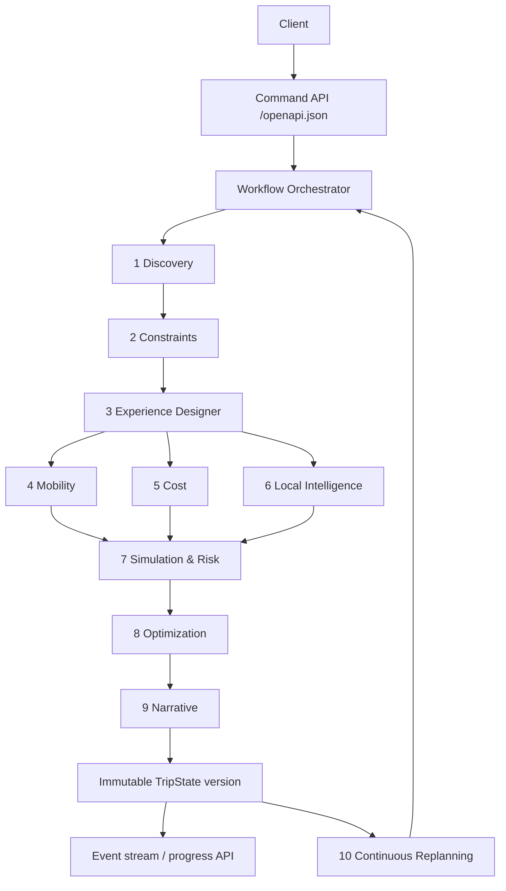

# System Contracts — Markdown Documentation

Welcome to the human-readable system design contract documentation for the **Agentic Travel Planner**.

While the machine-readable specifications reside in the [`/docs/json`](file:///Users/krishay/projects/tourism/docs/json) directory, this directory (`/docs/md`) provides rich, human-friendly Markdown equivalents explaining every schema, endpoint, agent patch ownership boundary, and integration fixture.

---

## 📚 Documentation Catalog

| Document | Description | Machine Source Equivalent |
|---|---|---|
| 📐 [**TripState Data Schema**](file:///Users/krishay/projects/tourism/docs/md/TRIP_STATE_SCHEMA.md) | Complete reference for `TripState`, sub-schemas (`$defs`), object hierarchies, constraints, and validation rules. | [`json/schemas/trip-state.schema.json`](file:///Users/krishay/projects/tourism/docs/json/schemas/trip-state.schema.json) |
| 🌐 [**OpenAPI Specification**](file:///Users/krishay/projects/tourism/docs/md/OPENAPI_SPECIFICATION.md) | Full breakdown of all 10 REST API endpoints, parameter schemas, request bodies, and asynchronous lifecycle operations. | [`json/openapi.json`](file:///Users/krishay/projects/tourism/docs/json/openapi.json) |
| 🛡️ [**Agent Patch Ownership**](file:///Users/krishay/projects/tourism/docs/md/AGENT_OWNERSHIP.md) | Detailed mapping of JSON Pointer write boundaries across all 10 specialized agents and the workflow orchestrator. | [`json/agent-ownership.json`](file:///Users/krishay/projects/tourism/docs/json/agent-ownership.json) |
| 🧪 [**Planning Run Fixture**](file:///Users/krishay/projects/tourism/docs/md/PLANNING_RUN_FIXTURE.md) | Walkthrough of the synthetic Kyoto integration fixture, candidate scoring, tradeoffs, and weather replan expectations. | [`json/examples/planning-run.json`](file:///Users/krishay/projects/tourism/docs/json/examples/planning-run.json) |

---

## 🏛️ High-Level System Architecture



---

## 🔍 Validation & Compliance

To run the automated structural contract checks locally:

```bash
python3 docs/tests/validate_contract.py
```

For full JSON Schema Draft 2020-12 validation in CI, use any standard validator against [`docs/json/schemas/trip-state.schema.json`](file:///Users/krishay/projects/tourism/docs/json/schemas/trip-state.schema.json).
